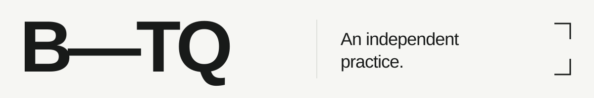
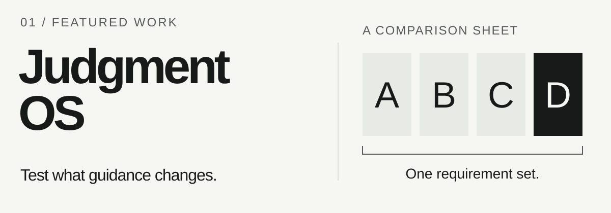

<picture>
  <source media="(prefers-color-scheme: dark)" srcset="assets/hero-dark.svg">
  <source media="(prefers-color-scheme: light)" srcset="assets/hero-light.svg">
  
</picture>

# Question assumptions. Build possibilities.

保持怀疑，也保持创造。

I'm **B-TQ**, a cross-disciplinary explorer working with AI, software and interaction. I build tools to test ideas, make abstract things tangible, and investigate how systems behave.

## 01 — Featured work

<a href="https://github.com/B-TQ/judgment-os">
  <picture>
    <source media="(prefers-color-scheme: dark)" srcset="assets/judgment-dark.svg">
    <source media="(prefers-color-scheme: light)" srcset="assets/judgment-light.svg">
    
  </picture>
</a>

### [Judgment OS](https://github.com/B-TQ/judgment-os)

**Test what your agent's Skills actually change.**

An offline-first evaluation toolkit for Agent Skills and prompts. Compare guidance under the same requirements; keep failures, missing runs and review limitations visible.

Python 3.11+ · Standard-library runtime · MIT

[Source](https://github.com/B-TQ/judgment-os) · [Releases](https://github.com/B-TQ/judgment-os/releases) · [Walkthrough](https://github.com/B-TQ/judgment-os/blob/main/docs/QUICKSTART.md) · [Evidence & limits](https://github.com/B-TQ/judgment-os/blob/main/docs/launch/EVIDENCE.md)

The optional meta-Skill is experimental. A general advantage over a one-sentence reminder has not been established.

## 02 — Other ways of making

### [Microchem Desktop · 微观化学演示台](https://github.com/B-TQ/microchem-desktop)

**Make molecular structure something you can explore.**

A Windows classroom application for rotating molecules, building crystal packings and walking through chemical reasoning. Core functions run offline with bundled RDKit.

Windows x64 · Published desktop application · Public distribution repository

[Download & demos](https://github.com/B-TQ/microchem-desktop#readme) · [Usage permission](https://github.com/B-TQ/microchem-desktop/blob/codex/public-release/docs/PERMISSION.md)

Downloadable software; prior written permission is required for use. Commercial use is prohibited. Full application source is not public.

---

### [dsh-wallpaper](https://github.com/B-TQ/dsh-wallpaper)

Local images and video as a configurable background for DeepSeek Harness. A small experiment in the atmosphere of everyday software.

JavaScript · Harness plugin · MIT · [Demo & setup](https://github.com/B-TQ/dsh-wallpaper#readme)

### [Windows App Relocation Diagnosis](https://github.com/B-TQ/windows-app-relocation-diagnosis)

An Agent Skill and PowerShell tools for investigating apps that break after a drive move or data migration. Start with logs and directory evidence; check preconditions before repair.

PowerShell · Diagnostic workflow · MIT · [Workflow & scripts](https://github.com/B-TQ/windows-app-relocation-diagnosis#readme)

## 03 — Questions I return to

**AI & judgment** — How do we tell when guidance actually helps?

**Learning & representation** — What changes when an abstract idea becomes something we can manipulate?

**Software & experience** — How can a tool be easier to inhabit, understand and repair?

---

Think. Build. Iterate. 
让问题落到作品里。
